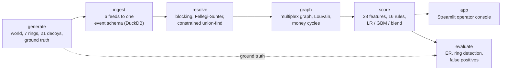

# Argus

**A synthetic-data benchmark for investigative analytics.** Argus covers
multi-source ingestion, entity resolution, graph analytics and explainable
risk scoring, all measured against criminal networks it plants itself.

> [!IMPORTANT]
> **Synthetic data only. For research and fraud-detection benchmarking. Not
> designed for, and must not be used for, monitoring real people.**
> Every person, account, phone number and event is fabricated by
> `argus generate`. Names come from Faker, so some match real people by
> coincidence; a name in an Argus alert says nothing about anyone real. See
> [Responsible use](#responsible-use).


[Quick start](#quick-start) · [Results](#results-at-a-glance) · [Public data](#results-on-public-benchmark-data) · [How it works](#how-it-works) · [Evaluation](#evaluation) · [Limitations](#known-limitations) · [Troubleshooting](#troubleshooting) · [Responsible use](#responsible-use)

## Why it exists

Anti-money-laundering and fraud teams build pipelines that fuse many messy
data feeds, work out who is who across them, map relationships, and rank
people for review. Fiction (the TV series *Person of Interest*) imagines the
end point as an all-seeing machine. Argus is a small, inspectable version of
that pipeline, built to answer two questions on data with known answers:

- how well does it find planted criminal rings?
- whom does it wrongly flag?

Because the generator knows the ground truth, entity resolution and detection
can be scored exactly, including where they fail. The individual methods are
also checked on public research datasets against published results; see
[Results on public benchmark data](#results-on-public-benchmark-data).

## Quick start

Requires Python 3.11+, about 1.6 GB of free disk (about 0.9 GB for the
virtual environment and 0.66 GB for the demo world) and about 1.5 GB of RAM.
DuckDB is embedded, so no database server is needed. Run everything from the
repository root.

```bash
python3 -m venv .venv && source .venv/bin/activate
pip install -e ".[dev]"

argus run --data data/demo        # 1,500 people, full pipeline: ~3 min, ~660 MB
argus evaluate --data data/demo   # metrics vs. ground truth -> data/demo/reports/evaluation.md
argus app --data data/demo        # operator console on http://localhost:8501 (Ctrl+C to stop)
```

A few useful variations:

```bash
argus run --data data/small --people 400              # quicker first look: ~1 min, ~190 MB, still 7 rings
argus evaluate --data data/demo --clean-control       # + false-positive control world (~3 more min, ~670 MB)
argus run --data data/pit --point-in-time             # no look-ahead: train on the past, score the latest quarter
python -m pytest                                      # test suite, ~1 min; builds its own 320-person world
```

`argus` is the same as `python -m argus`, and every command has `--help`.

<details>
<summary>Running stages one at a time, and generator options</summary>

The stages run in this order. Each one reads and writes the same `--data`
directory, which defaults to `data/demo`:

```bash
argus generate --data data/demo --people 1500 --seed 42   # raw feeds + ground truth
argus ingest   --data data/demo                           # rebuilds data/demo/argus.duckdb
argus resolve  --data data/demo
argus graph    --data data/demo
argus score    --data data/demo
```

`generate` and `run` accept these options:

- `--people` (default 1500), `--seed` (42), `--days` (182) and `--start` (2026-01-01);
- `--clean`, which generates a world with no planted rings.

`run --skip-generate` reprocesses an existing world. The same `--seed`
produces byte-identical raw files, whatever Python's hash seed.

A run leaves the following in `data/demo/` (git-ignored):

- `manifest.json`;
- `raw/` (the six feeds);
- `ground_truth/`;
- `argus.duckdb`;
- `models/`;
- `reports/`;
- `case_actions.jsonl` (analyst dispositions; the console creates it when the
  first one is recorded).

</details>

## Results at a glance

Three independent worlds of 1,500 people each (seeds 42, 7 and 2024). Each
world contains seven planted rings and 21 benign look-alikes, and each seed
also gets a separate clean control world (seed + 1000) with no planted rings.
An entity is **alerted** when its risk score is at least 45.

| Metric | Mean (range over 3 seeds) |
|---|---|
| Entity resolution precision (person records, excl. anonymous phone lines) | 0.996 (0.996-0.998) |
| Entity resolution recall (same records) | 0.927 (0.924-0.930) |
| Rings detected (at least half of members alerted) | 7 of 7 in every seed |
| Ring-member recall (person level) | 0.89 (0.88-0.90) |
| Alert precision | 0.92 (0.90-0.96) |
| Alert recall (entity level, incl. split-off fragments of members) | 0.60 (0.60-0.61) |
| Model average precision, grouped cross-validation | 0.94 (0.93-0.96) |
| Same, the 16 rules alone | 0.79 (0.77-0.83) |
| People alerted in a world with no planted rings | 0.16% (0.07-0.20%) |

Member recall varies by typology:

| Typology | Member recall |
|---|---|
| Mule funnels | 0.97 |
| Structuring | 0.91 |
| Shell layering | 0.75 |
| Insider collusion | 0.67 |

The shell rings' accountant was **never** alerted (0 of 6): their only
footprint is a few e-mails and calls. Full tables are in
[`reports/benchmark.md`](reports/benchmark.md); failures are analyzed in
[`docs/FAILURE_MODES.md`](docs/FAILURE_MODES.md).

**Without look-ahead.** The numbers above let every feature see all six
months, including activity after the cases used as labels were opened. With
`--point-in-time`, models train on the quarter before the first case opened
and every score uses only the latest quarter
([`reports/benchmark_point_in_time.md`](reports/benchmark_point_in_time.md)):

| Metric | Whole window | Point-in-time |
|---|---|---|
| Model average precision (cross-validated, predicted on the later quarter) | 0.94 | 0.85 (0.84-0.87) |
| Ring-member recall | 0.89 | 0.62 (0.57-0.64) |
| Same, rings active at least 14 days in the scoring quarter | - | 0.67 (0.60-0.71) |
| Rings detected | 7 of 7 | 5 of 7 (4-6) |
| Alert precision | 0.92 | 0.89 (0.83-0.98) |
| People alerted in the clean world | 0.16% | 0.04% (0-0.13%) |
| All alerts in the clean world (every one false), per world | 2.3 | 3.3 (2-4); most are watch-list entries with no activity, or companies |

Some of the drop is look-ahead and some is the shorter window: mule rings that
stop early (mules 18 of 44) and the insider (0 of 3) barely show in the last
quarter.

### Limits of the numbers

> [!WARNING]
> Read these results as a self-test of this generator, not as evidence of
> real-world performance.

- **Circular.** One author wrote both the generator and the detectors, so the
  detectors look for what the generator plants. For example, ring wires are
  preceded by calls 30 minutes to 4 hours earlier, and one feature counts
  calls within 4 hours before a large transfer. The entity-resolution
  normalizer also reuses the generator's nickname, suffix and
  street-abbreviation tables.
- **Unrealistic prevalence.** About 3-4% of labelled entities are positive;
  real portfolios are closer to 0.1% or less. At that prevalence, with the
  same recall and clean-world false-positive rate, about two of every three
  alerts would be false (precision ≈ 0.36).
- **Perfect labels.** Every ring member and ring company is labelled as a
  confirmed case. Real case outcomes are partial, delayed and biased.
- **Look-ahead by default.** Features use the whole 6-month window; the
  point-in-time numbers above show what removing it costs.
- **A static world.** It is a single metro area with no adaptive adversaries.

## Results on public benchmark data

The synthetic results above cannot show how Argus does on real data, so
`argus realworld` runs Argus's models (with their configuration unchanged)
and entity-resolution components on public research datasets, and compares
them with published numbers. None of these datasets is about people
(DBLP-ACM's only personal data are the public author lists of papers), and
the synthetic-only guard on `argus ingest` is unchanged. Tables,
data provenance and caveats are in
[`reports/realworld.md`](reports/realworld.md).

| Dataset (what it tests) | Protocol | Argus, measured here | Published |
|---|---|---|---|
| DBLP-ACM (entity resolution) | Whole problem; precision and recall over all 2,224 true matches | F1 0.989 with no labels (Fellegi-Sunter); 0.988-0.991 supervised | Mostly 0.96-0.98 (FEBRL SVM 0.976); Fellegi-Sunter via ECM 0.09. Protocols differ in detail |
| DBLP-ACM | DeepMatcher's pre-blocked split, test F1 | 0.988 (gradient boosting) | Magellan 0.984, DeepMatcher 0.984, Ditto 0.990 |
| ULB credit card (transaction scorer) | Out-of-time 80/20, ROC-AUC | 0.986 (auto-selected blend; 95% CI 0.976-0.996); logistic regression alone 0.980 | 0.985-0.992 (AutoML systems, Fraud Dataset Benchmark) |
| ULB credit card | Random 60% train, AUPRC. Argus: stratified, 40% test, 5 seeds; published: 60/20/20, not stratified | 0.841 ± 0.010, mean ± sd (blend); logistic regression 0.776 | 0.587 (logistic regression) to 0.849 (self-paced ensemble); different split, not directly comparable |
| Elliptic (graph features) | Time steps 1-34 train, 35-49 test | **Not run:** the data host is blocked in the environment this was built in | Random forest illicit F1 0.788 (Weber et al. 2019) |

What this does and does not show:

- Argus's string comparator, title embedding and models, combined with
  blocking, Fellegi-Sunter and one-to-one linking written for this benchmark,
  reach the level of published classical systems on real records. The person
  resolver's own blocking and hand-set weights are not tested, and DBLP-ACM is
  an easy benchmark.
- On real card data, Argus's automatic model choice, validated on the latest
  part of the training period only, picked the blend of its two models, which
  lands inside the AutoML range out-of-time (ROC-AUC 0.986). This came after
  three changes made after earlier runs on this data: the original gradient
  boosting diverged at 0.17% prevalence (ROC-AUC 0.57-0.86 across seeds) and
  was replaced by a regularized booster chosen on synthetic data only; the
  blend was adopted because it improved detection on synthetic development
  worlds; and the time-validated choice was added after the per-model test
  results were known. Gradient
  boosting alone is still the weakest model out-of-time (0.870). See
  [`docs/FAILURE_MODES.md`](docs/FAILURE_MODES.md#6-on-public-benchmark-data).
- Nothing here validates the multi-source fusion, the typology rules or the
  risk blend. No public dataset links bank, phone, badge and e-mail records
  of the same people, and none should.
- The credit-card file and the three Leipzig DBLP-ACM files came from public
  mirrors. The credit-card file was accepted only after matching its
  documented byte size and its row and fraud counts; the Leipzig files, which
  have no documented size, only after matching the documented record and
  match counts. Each file's source and SHA-256 is recorded.

```bash
argus realworld fetch   # download into data/external/ (not committed); ~160 MB without Elliptic
argus realworld run     # ~4 min without Elliptic; writes reports/realworld.md and .json
```

## How it works



| Path | Stage | Start reading at |
|---|---|---|
| `argus/generate/` | Synthetic world and raw feeds | `world.py`, `scenarios.py` |
| `argus/ingest/` | Adapters to the common schema; synthetic-data check | `base.py`, `guard.py` |
| `argus/resolve/` | Entity resolution | `matching.py`, `clustering.py` |
| `argus/graph/` | Relationship graph analytics | `analytics.py` |
| `argus/score/` | Features, rules, models, narratives | `rules.py`, `model.py` |
| `argus/app/` | Operator console | `dashboard.py` |
| `argus/evaluate/` | Metrics against ground truth | `metrics.py` |
| `scripts/` | Evaluation entry points and the benchmark | `run_benchmark.py` |
| `tests/` | One test module per package | `conftest.py` |
| `docs/` | [Data dictionary](docs/DATA_DICTIONARY.md), [failure modes](docs/FAILURE_MODES.md), screenshots | |
| `reports/` | The committed 3-seed benchmark | `benchmark.md` |
| `data/` | Generated worlds (git-ignored, reproducible from seeds) | |

### Synthetic world

A default world has 1,500 adults (Faker, fixed seed) in households across 18
invented towns. It includes:

- 36 employers, six of them with badge-controlled campuses;
- merchants with ISO 18245 category codes;
- a social graph that drives calls, e-mail and peer-to-peer payments.

It produces four activity feeds, each in the conventions of a different kind
of source system:

| Feed | Format |
|---|---|
| Bank | Double-entry bank ledger with per-bank date formats |
| Telco | Call-detail records with numbers stored as dialed |
| Access control | Badge-swipe JSON export |
| E-mail | Header metadata only |

Two more feeds come with them: an internal watch-list and historical case
outcomes, which are the only labels the pipeline receives. Every file is
described in the [data dictionary](docs/DATA_DICTIONARY.md).

Identity records are deliberately messy, with:

- typos;
- nicknames;
- `LAST, FIRST` ordering;
- maiden names;
- day/month swaps in dates of birth;
- stale addresses;
- mixed phone formats.

Most defect rates are set in `NoiseConfig`; name layouts (such as
`LAST, FIRST`) and phone formats are per-source conventions hard-coded in
`argus/generate/reference.py` (`BANKS`) and `argus/generate/identity.py`.
Seven rings across four typologies are
planted on top of ordinary lives, loosely modeled on public AML guidance
(FATF typology reports, FinCEN advisories). No real case data was used.

| Typology | Rings | What is planted |
|---|---:|---|
| Shell layering | 2 | A front company and 3-5 shell LLCs at one virtual-office address. Wires round-trip and lose 0.4-2.2% per hop, preceded by "invoice" e-mails and burner-phone calls. There are after-hours meetings at a co-working space. |
| Structuring | 2 | Smurfs make cash deposits of $8,150-$9,950 at different branches and funnel them to a cash-intensive front. The coordinator calls from a burner beforehand. |
| Mule funnel | 2 | Scam victims pay newly opened mule accounts. The mules forward 85-92% within hours to a herder or a crypto on-ramp. |
| Insider collusion | 1 | An employee makes after-hours visits to a restricted room (server room, records room or loading dock, depending on department) and e-mails large attachments to a personal mailbox. They receive round "consulting fees" and meet the outsider at a storage facility. |

What makes detection hard is the innocent look-alikes:

- **21 decoys:** savings clubs, landlord LLCs, cash businesses, freelancers,
  a night shift.
- **Population-wide background behavior:**
  - anonymous prepaid phones;
  - one-off cash deposits;
  - switching banks;
  - round wires for cars and tuition;
  - family loans;
  - IT on-call visits to the server room;
  - e-mailing big files to oneself.

### Ingestion

Each feed has an adapter that emits two things:

- **events** in one schema: `event_id, ts` (UTC), `source, event_type,
  actor_ids, actor_roles, attributes`. The actors are typed identifiers such
  as `acct:...`, `msisdn:...`, `card:...` and `email:...`, not people.
- **identity records:** KYC profiles, subscribers, cardholders, mailboxes and
  watch-list entries, each with the identifiers it owns.

The adapters handle the format work:

- inferring date formats;
- converting local time (with DST) to UTC;
- collapsing ledger legs into single transfers;
- normalizing numbers recorded as dialed.

Rejected rows are logged to `ingest_log`. Adding a feed means writing one
adapter module; see [Extending](#extending).

### Entity resolution

- **Blocking.** Eight key types, designed so that each injected defect leaves
  at least one key intact. Six are for people:
  - phone;
  - e-mail;
  - surname sound + first initial;
  - first-name sound + DOB (survives a surname change);
  - house number + street + ZIP;
  - surname sound + birth year.

  Two are for companies: name and tax ID. Oversized blocks are dropped and
  reported.
- **Deterministic links.** A shared phone number or e-mail address links two
  person records outright, unless their names, dates of birth or suffixes
  conflict. A shared tax ID links two companies.
- **Fellegi-Sunter matching.** Every other pair is scored on Jaro-Winkler name
  levels, date of birth (exact, day/month swap or near), phone, e-mail,
  address, employer and an optional character n-gram embedding:
  - `m` comes from the generator's defect rates;
  - `u` is estimated from random pairs, with term-frequency adjustment, so
    "Kowalczyk" counts for more than "Smith".

  A link needs a posterior p ≥ 0.90. Evidence for each linked pair is stored
  and shown in the console.
- **Guards.**
  - When first names disagree, positive address evidence is discarded, so
    household members don't merge.
  - Non-exact names need corroboration from DOB, phone, e-mail, address or
    employer.
  - A work mailbox and a personal mailbox are treated as not comparable.
- **Constrained union-find.** Links are applied strongest first. A merge is
  refused when the two clusters have incompatible dates of birth, so a
  DOB-less record cannot chain a father and son together.

### Relationship graph

The graph is a NetworkX projection of resolved people and companies, plus any
accounts and phones nobody owns. Its edges are:

- money;
- calls and SMS;
- e-mail (excluding bulk mail);
- small-group co-location from badge swipes;
- beneficial-ownership control.

Each edge has a 45-day recency half-life and is scaled per channel. Hubs such
as switchboards and billers are dropped.

The analytics on top of it:

- **Centrality:** degree, strength, sampled betweenness and PageRank.
- **Communities:** Louvain, run on a subgraph of substantial money, control
  and co-location ties. On the full social graph it mostly finds families
  ([details](docs/FAILURE_MODES.md#2-relationship-graph)).
- **Flagged communities:** robust z-scores on seven money-flow features:
  - large internal volume;
  - wire count;
  - sub-threshold cash;
  - money cycles;
  - round large transfers;
  - young or shared-address companies;
  - crypto outflow.
- **Money cycles that preserve value over time:** each hop must follow within
  10 days and keep 80-102% of the value. Companies are collapsed into their
  beneficial owners, so a round trip that ends at the organizer personally
  still closes.

### Risk scoring

**Features.** There are 38 per resolved entity, covering:

- money velocity, fan-in and 72-hour pass-through;
- round amounts, structuring, wires, crypto spend, young-account inflow and
  cycles;
- control of shell-like companies;
- contact with watch-listed entities and unregistered prepaid lines;
- calls shortly before large transfers;
- after-hours restricted access and denied swipes;
- large outbound attachments;
- centrality and community flags.

**Rules and models.**

- **16 red-flag rules.** Each one writes its own evidence, for example
  "5 cash deposits between $8,000 and $9,999 across 3 branch(es)".
- **Three candidate models,** trained on the case outcomes: logistic
  regression, gradient boosting (scikit-learn's histogram booster with an L2
  leaf penalty) and their blend (the mean of the two probabilities). The one
  with the best cross-validated average precision is chosen. With
  `--point-in-time`, models train on an earlier window and are judged on
  predictions for the latest one.
- **Cross-validation folds are grouped by Louvain community.** This limits
  leakage between related entities, but does not remove it: Louvain often
  splits a ring across communities.
- **Labelled entities always show an out-of-fold score.**

**Explanations.**

- Logistic regression contributions are exact: coefficient × standardized
  value.
- Gradient boosting and blend contributions use occlusion; their global
  importance is the mean absolute occlusion contribution.
- Global importance is shown next to held-out permutation importance.

**Final risk:**

```
risk = max( 0.4 · rules + 0.6 · 100 · p_model ,  0.8 · rules )
```

The *rule floor* (the second term) keeps rare typologies from being diluted
by a model with almost no examples of them:

- without it, the insider would have scored about 24/100 (model p ≈ 0.001)
  despite five rules firing;
- with it, the insider scored 48;
- it also produced 3 of the 6 false alerts in seed 42.

Every score comes with its rule hits, its model drivers and an analyst-style
narrative.

### Operator console

`argus app --data <dir>` opens five tabs:

- **Alert queue:** ranked entities with filters.
- **Investigation:**
  - the narrative and rules;
  - the score decomposition;
  - the merged records, with match evidence;
  - money movements, cycles and contacts;
  - places on a map;
  - dispositions, appended to `<dir>/case_actions.jsonl`.
- **Network:** an interactive ego or community graph.
- **Timeline:** every event by channel.
- **Model & benchmark:** cross-validation metrics, feature importance, and
  `<dir>/reports/evaluation.md`.

<table>
<tr>
<td width="50%"><br><sub><b>Investigation:</b> narrative, rule hits, score decomposition</sub></td>
<td width="50%"><br><sub><b>Network:</b> ego graph of a money mule</sub></td>
</tr>
<tr>
<td><br><sub><b>Timeline:</b> every event by channel</sub></td>
<td><br><sub><b>Model & benchmark:</b> cross-validated metrics and importances</sub></td>
</tr>
</table>

On a remote or headless machine the server opens no browser. Forward the port
with `ssh -L 8501:localhost:8501 you@host`. `argus app` accepts only
`--data`, so set the port or address through Streamlit's environment, for
example `STREAMLIT_SERVER_PORT=8600 argus app --data data/demo`.

## Evaluation

`argus evaluate --data <dir>` writes `<dir>/reports/evaluation.md` and
`evaluation.json`. The console's Model & benchmark tab shows them. They
cover:

- **Entity resolution:** pairwise precision, recall and F1, plus B-cubed F1
  by slice, recall by source pair, and missed links by likely cause.
- **Detection:** per-ring member recall, alert precision and recall,
  precision@K, and alert rates among decoys and scam victims.
- **`--clean-control`:** additionally builds `<dir>_clean_control/`, a world
  of the same size with no planted rings (seed + 1000, replaced on every run).
  It is scored with the model trained on `<dir>`, so every alert there is a
  false positive.

`scripts/eval_entity_resolution.py` and `eval_ring_detection.py` print each
part on its own. `eval_false_positives.py` rebuilds `<dir>_clean_control/`
as `--clean-control` does (~3 min, ~670 MB) and prints its false-positive
rate.

To reproduce the committed benchmark:

```bash
python scripts/run_benchmark.py                          # seeds 42 7 2024: ~15 min, ~3.9 GB in data/bench/
python scripts/run_benchmark.py --point-in-time --out data/bench_pit   # ~24 min -> reports/benchmark_point_in_time.md
python scripts/run_benchmark.py --report-dir data/bench  # same, without overwriting reports/
```

## Extending

**A new feed** is one adapter class in a new module under
`argus/ingest/adapters/`, imported in that package's `__init__.py` so that
`argus ingest` registers it. Nothing downstream changes. See
`tests/test_ingest.py::test_new_feed_needs_only_an_adapter`.

```python
from argus.ingest import SourceAdapter, register_adapter

@register_adapter
class ParkingAdapter(SourceAdapter):
    name = "parking"                 # raw files live in <dir>/raw/parking/

    def events(self):                # yield DataFrames with columns
        yield frame                  # event_id, ts (UTC), source, event_type,
                                     # actor_ids, actor_roles, attributes
```

`records()` is optional; it returns identity records.

**A new typology** is the honest way to stress the benchmark: plant something
the detectors were not designed for and see whether they notice.

1. Subclass `Scenario` in `argus/generate/scenarios.py`.
2. Register it in `TYPOLOGIES`.
3. Add it to `GeneratorConfig.scenario_mix`.
4. Re-run `argus run` and `argus evaluate`.

## Known limitations

Each of these is measured in [`docs/FAILURE_MODES.md`](docs/FAILURE_MODES.md):

- **Missed roles:** people with no money footprint, such as the shell rings'
  accountant, are never alerted.
- **Rare typologies** need the rule floor, at the cost of extra false
  positives.
- **Name-only records:** records with only a common name (badges, mailboxes)
  stay unresolved, at 264-284 records per world.
- **Louvain** recovers families and teams far better than rings; most money
  cycles are innocent family loans.
- **Guilt by association:** contact with flagged people pushes relatives and
  scam victims up the queue.
- **Benign look-alikes:** three of seed 42's seven night-shift workers are
  alerted (after-hours restricted access, as the insider has, plus after-hours
  small-group meetings, as the shell rings have); the other two seeds alert
  none.
- **Look-ahead:** the default scores use all six months; without it
  (`--point-in-time`) member recall falls from 0.89 to 0.62.

## Troubleshooting

- **`error: externally-managed-environment` from pip:** install into a
  virtual environment, as in the Quick start.
- **`NonSyntheticDataError: .../manifest.json not found`:** `--data` does not
  point at a generated world. Paths are relative to the current directory, so
  run from the repository root, or run `argus generate` first.
- **The console says `argus.duckdb not found`:** run `argus run --data <dir>`
  first, or fix the path in the sidebar.
- **A DuckDB lock error when re-running a stage:** stop the console first
  (Ctrl+C). It holds the warehouse open and caches it, so restart it
  afterwards to see new results.
- **Mixed-up months after regenerating:** `generate` overwrites files but
  never deletes old ones. When you change `--start` or `--days`, use a fresh
  `--data` directory.

## Responsible use

- **Checked at ingest, not enforced.** `argus ingest` does three things:
  - it refuses a directory without the generator's `manifest.json`;
  - it drops rows whose phone number or e-mail address falls outside the
    fictional ranges (NANP `555-01XX`; RFC 2606 `.example` and `.test`);
  - it aborts if more than 0.1% of a feed's rows do.

  This is a tripwire against accidents, not a safeguard. Anyone can edit the
  manifest or the code, and later stages do not re-check.
- **The numbers describe this generator, not the world** (see
  [Limits of the numbers](#limits-of-the-numbers)).
- **Public benchmark data only for external checks.** `argus realworld` uses
  anonymized Bitcoin transactions, PCA-transformed card transactions and
  bibliographic records of published papers. It downloads them on demand,
  never commits them, and never passes them to the person-level pipeline.
  DBLP-ACM's author names are public authorship metadata; they are used only
  as a string field for matching papers and never appear in a report.
- **Fused communications, location and financial data is surveillance
  infrastructure.** Real deployments need:
  - legal authority;
  - purpose limitation;
  - data minimization;
  - human review of every alert;
  - an audit trail.

  Features such as contact with flagged people harm innocent relatives and
  scam victims; [`docs/FAILURE_MODES.md`](docs/FAILURE_MODES.md) quantifies
  this.
- **Do not use Argus to make decisions about real people.**

## License

No license has been chosen yet. The usage restriction above states the
author's intent; it is not a license term.
