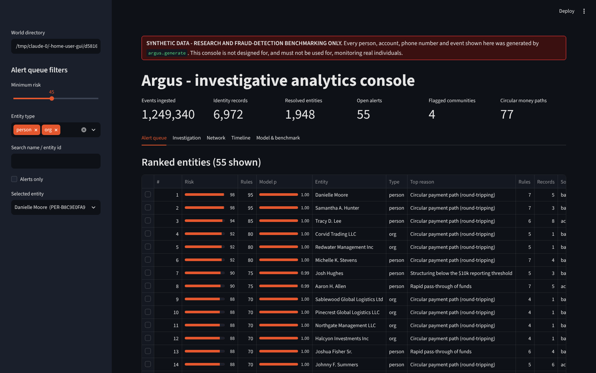
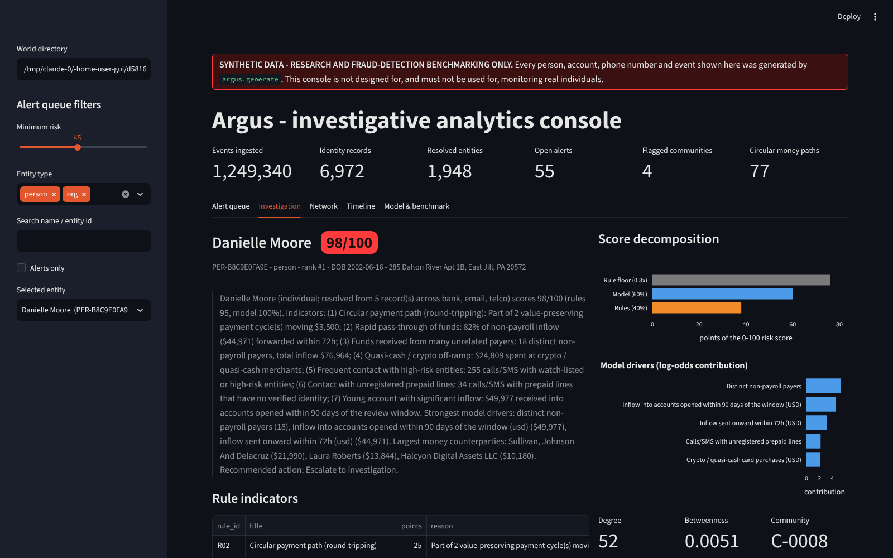
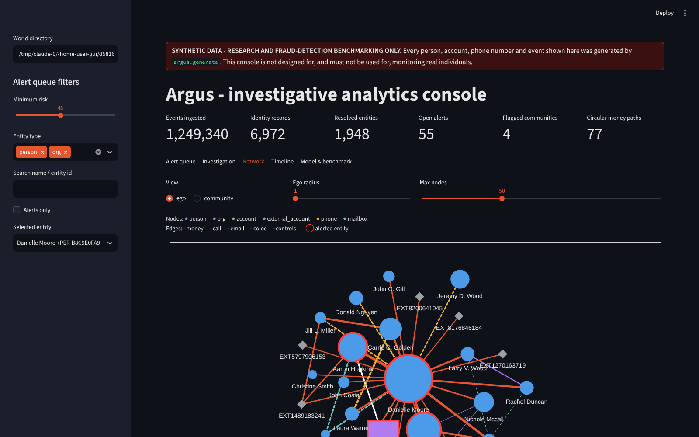
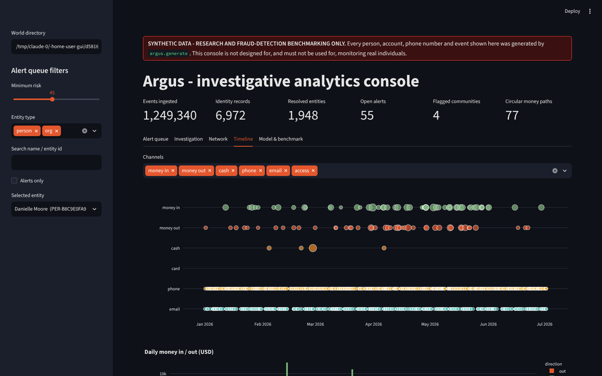
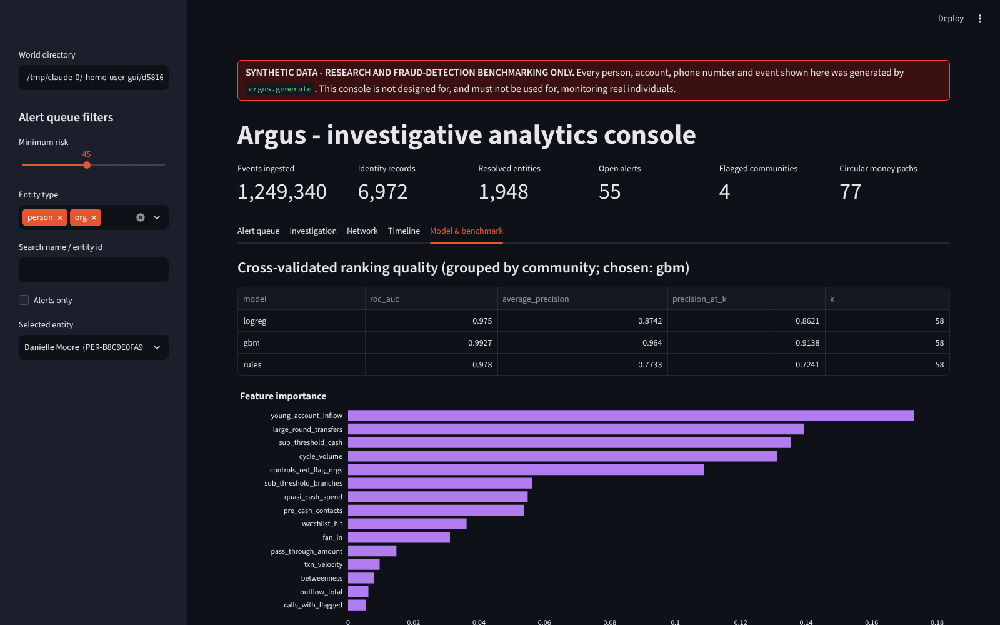

# Argus - a synthetic-data investigative analytics benchmark

> **Research and fraud-detection benchmarking only.**
> Argus runs exclusively on synthetic data that it generates itself. It is **not
> designed for, and must not be used for, monitoring real individuals**. No real
> people, no real identifiers, no scraping, no live feeds. The ingest layer
> enforces this: it refuses any data directory that lacks the generator's
> synthetic-data manifest, and aborts if phone numbers or e-mail addresses fall
> outside the namespaces reserved for fiction (NANP `555-01XX`, RFC 2606
> `.example`).

Argus is a working prototype of the architecture behind fictional "see
everything" systems (the TV series *Person of Interest* is the obvious
inspiration). It is grounded in what real financial-intelligence and
fraud-analytics stacks actually do:

1. many messy, independent data feeds;
2. identity fusion (entity resolution) across them;
3. a relationship graph;
4. explainable risk scoring;
5. an analyst console.

Because every byte is synthetic and the generator plants criminal networks
with known ground truth, every stage can be **measured**, including where it
fails.



| Investigation (evidence panel) | Network (ego graph of a mule) |
|---|---|
|  |  |
| **Timeline** | **Model & benchmark** |
|  |  |

---

## Quick start

```bash
pip install -e ".[dev]"                     # Python >= 3.10

python -m argus run --data data/demo        # generate 1,500 people + run the full pipeline (~4 min)
python -m argus evaluate --data data/demo --clean-control   # metrics vs. ground truth + false-positive control
python -m argus app --data data/demo        # operator console on http://localhost:8501

pytest                                      # 46 tests, ~1 min
python scripts/run_benchmark.py --seeds 42 7 2024           # multi-seed benchmark -> reports/benchmark.md
```

Each stage can also run on its own: `argus generate | ingest | resolve | graph | score`.
Every run is deterministic: the same `--seed` produces byte-identical raw
files, independent of Python's hash seed.

## Architecture

```
 argus.generate            argus.ingest              argus.resolve            argus.graph              argus.score            argus.app
 ───────────────           ────────────              ─────────────            ───────────              ───────────            ─────────
 population, households    one adapter per feed      normalize names,         entity projection of     ~38 features per        Streamlit console:
 employers, merchants  ──► (bank, telco, access, ──► addresses, DOBs     ──►  money / call / e-mail /  entity            ──►  alert queue, evidence
 4 noisy raw feeds         e-mail, watch-list,       blocking (7 keys)        co-location / control    16 explainable rules     panel, network, timeline,
 7 planted networks        labels) -> common         Fellegi-Sunter weights   edges, recency-weighted  logistic regression +    dispositions
 21 benign look-alikes     event schema in DuckDB    constrained union-find   centrality, Louvain,     gradient boosting
 ground truth              synthetic-data guard      entity links             flagged clusters,        (grouped CV), narratives
                                                                              temporal money cycles
                                                       argus.evaluate: ER precision/recall, ring detection, decoy & clean-world false positives
```

| Package | What it does | Key files |
|---|---|---|
| `argus/generate/` | Synthetic world and raw feeds | `population.py`, `holdings.py`, `sources/*.py`, `scenarios.py`, `decoys.py`, `background.py`, `identity.py`, `world.py` |
| `argus/ingest/` | Source-agnostic ingestion into DuckDB | `base.py` (adapter contract and registry), `adapters/*.py`, `guard.py`, `pipeline.py` |
| `argus/resolve/` | Entity resolution | `normalize.py`, `blocking.py`, `matching.py`, `embedding.py`, `clustering.py`, `evaluate.py` |
| `argus/graph/` | Relationship graph analytics | `build.py`, `analytics.py` |
| `argus/score/` | Risk scoring and explanations | `features.py`, `rules.py`, `model.py`, `narrative.py` |
| `argus/app/` | Operator console | `dashboard.py`, `data.py`, `graphview.py` |
| `argus/evaluate/` | Benchmark metrics | `truth.py`, `metrics.py`, `report.py` |
| `scripts/` | Evaluation entry points | `eval_entity_resolution.py`, `eval_ring_detection.py`, `eval_false_positives.py`, `run_benchmark.py` |
| `tests/` | One test module per package | |

See [`docs/DATA_DICTIONARY.md`](docs/DATA_DICTIONARY.md) for every file and
table, and [`docs/FAILURE_MODES.md`](docs/FAILURE_MODES.md) for where the
system breaks.

## 1. The synthetic world (`argus.generate`)

**Population.** By default the world has N = 1,500 adults (Faker, fixed seed),
living in households across 18 invented towns:

- households have shared addresses;
- spouses take each other's surnames, so maiden names survive in older records;
- some households have a Jr./Sr. father and son;
- about 13% of people moved recently, so stale addresses linger in some records.

People work at 36 employers, and six of them run badge-controlled campuses.
Merchants carry real ISO 18245 category codes. A social graph of household,
friend and coworker ties drives calls, e-mail and peer-to-peer payments.

**Four noisy feeds plus two reference feeds.** Each mimics a different kind
of source system (formats in the [data dictionary](docs/DATA_DICTIONARY.md)):

| Feed | Realism |
|---|---|
| Bank (3 fictional banks) | Double-entry ledger legs with settlement lag; per-bank name casing and DOB formats; payroll on the ACH business-day calendar (federal holidays included); log-normal card spend by merchant category and hour of day; round rents vs. non-round mortgages; ATM cash |
| Telco | Monthly CDR partitions; numbers recorded as dialled; serving cell IDs; nickname subscribers; anonymous prepaid SIMs; switchboard "service numbers" that everyone calls |
| Access control | PACS JSON export; turnstiles, floors, server and records rooms, co-working spaces, gyms, self-storage; remote days, lunch exits, denials, a warehouse night shift |
| E-mail headers | RFC 5322 metadata, varying display names, attachments, bulk mail |
| Watch-list | One leader per ring, plus stale entries for innocent people and for people who don't exist |
| Case outcomes | Historical dispositions: the only labels the pipeline gets |

**Identity noise**, so that matching is genuinely hard:

- keyboard and OCR typos;
- nicknames ("Bob" for Robert) and initials;
- `LAST, FIRST` ordering;
- maiden names in older records;
- dropped suffixes;
- day/month swaps and digit errors in dates of birth;
- missing fields;
- stale addresses and inconsistent street-suffix abbreviations;
- phone-number formats such as `(201) 555-0142` vs `12015550142`;
- people holding several phone lines and mailboxes.

**Seven planted networks**, each spanning several feeds and based on
published AML/fraud typologies:

| Typology | What the generator plants |
|---|---|
| `shell_layering` (2) | A front company and 3-5 shell LLCs registered at one virtual-office address. Round-tripped wires lose 0.4-2.2% per hop. "Invoice" e-mails go out the day before. The organiser coordinates by phone (mostly burners, with occasional operational-security slips). After-hours meetings take place at a co-working space. |
| `structuring` (2) | Smurfs deposit $8,150-$9,950 in cash at different branches, then funnel it to a cash-intensive front. The coordinator phones from a burner beforehand. |
| `mule_funnel` (2) | Scam victims pay newly opened mule accounts. The mules forward 85-92% within hours to a herder or a crypto on-ramp. Heavy SMS traffic follows, after a recruitment e-mail. |
| `insider_collusion` (1) | Over 6-11 weeks, an employee makes after-hours visits to a server or records room. Denied swipes follow, and large attachments go to their personal mailbox and then to a drop box. The outsider pays round "consulting fees", and the two meet at a storage facility. |

**Benign look-alikes**, which are what make the benchmark hard. The 21
**decoys** are rotating savings clubs, landlord LLCs, cash businesses,
freelancers and a night shift. On top of them, population-wide **background
behaviour** looks like each typology without being suspicious:

- anonymous prepaid phones;
- one-off large cash deposits;
- switching banks;
- round-sum wires for cars, tuition and home deposits;
- family loans repaid within days;
- IT on-call visits to the server room;
- e-mailing big files to oneself.

## 2. Ingestion (`argus.ingest`)

Every feed is mapped to one schema: **`Event(timestamp UTC, source,
event_type, actor_ids, actor_roles, attributes)`**. Actors are *typed
identifiers* (`acct:`, `msisdn:`, `card:`, `email:`, `loc:` ...), not people.
Who stands behind an identifier is decided later, by entity resolution.

Feeds also emit **`IdentityRecord`s**: a KYC profile, a subscriber, a
cardholder, a display name or a watch-list entry, together with the
identifiers each record owns.

What the adapters handle:

- inferring each file's date and time formats;
- converting local wall-clock times (with DST) to UTC;
- collapsing double-entry ledger legs into single transfers;
- normalising numbers that were recorded as dialled;
- logging data-quality rejects to `ingest_log`.

**Adding a feed is one class**, and nothing downstream changes (see
`tests/test_ingest.py::test_new_feed_needs_only_an_adapter`):

```python
@register_adapter
class ParkingAdapter(SourceAdapter):
    name = "parking"
    def events(self):
        yield dataframe_in_the_common_schema
```

## 3. Entity resolution (`argus.resolve`)

- **Normalization** - names (comma order, titles, suffixes, nickname → formal
  name sets, initials), USPS-style address standardization, org-name suffixes.
- **Blocking** - seven keys designed so that each realistic defect leaves at
  least one key intact: phone, e-mail, `metaphone(last)+initial`,
  `metaphone(first)+DOB` (survives a surname change), house number + street + ZIP,
  `metaphone(last)+birth year`, org name / tax ID. Oversized blocks are
  dropped and reported.
- **Matching** - Fellegi-Sunter log-likelihood weights over agreement
  levels:
  - **names:** Jaro-Winkler exact / fuzzy / initial;
  - **DOB:** exact / day-month swap / near (typo);
  - **contact and identity:** phone, e-mail, address, employer;
  - **optional embedding:** an LSA embedding of character n-grams.

  `m` comes from documented defect rates. `u` is estimated from random record
  pairs with term-frequency adjustment, so agreeing on "Kowalczyk" outweighs
  agreeing on "Smith". Every scored pair stores its per-field weights as
  evidence (shown in the console).
- **Guards for the independence assumption.** Address evidence is ignored
  when first names conflict, so household members don't merge. Non-exact name
  matches need corroboration from DOB, phone, e-mail, address or employer. A
  work and a personal mailbox are "not comparable" rather than a disagreement.
- **Constrained union-find** - links are applied strongest first, and a merge
  is refused when the two clusters carry incompatible dates of birth. This
  stops a DOB-less record from chaining a father and son together. In the
  default world it refuses about 160 merges, and in a 400-person world every
  refusal was checked against truth and found correct.

## 4. Relationship graph (`argus.graph`)

**Graph.** A NetworkX multiplex projection: person and org entities, plus
account and phone nodes that nobody owns. Its edges, each recency-weighted
with a 45-day half-life and scaled per channel to [0, 1], are:

- money transfers;
- calls and SMS;
- e-mail (excluding bulk mail);
- small-group co-location from badge swipes. Turnstiles and any
  reader-window with more than six people are ignored, and a two-person
  meeting counts more than a six-person one.

Beneficial-ownership `controls` links tie owners to their companies.
Switchboards and billers are detected as hubs and dropped.

**Analytics.**

- **Centrality:** degree, strength, betweenness (sampled, distance = 1/weight)
  and PageRank.
- **Communities:** Louvain, run on an *investigative subgraph* of substantial
  money, control and co-location ties. Run on the full social graph, it mostly
  recovers families and teams, as `docs/FAILURE_MODES.md` shows.
- **Flagged clusters:** tightly connected communities with unusual money flow,
  scored by robust z-scores on six money-flow features: internal wire volume,
  sub-threshold cash, cycles, round large transfers, young or shared-address
  companies, and crypto outflow.
- **Value-preserving temporal money cycles:** each hop must follow the previous
  within 10 days and keep 80-102% of the value. Cycles are searched on a graph
  where each company is collapsed into its beneficial owner, which exposes
  round-trips that end at the organiser personally.

## 5. Risk scoring (`argus.score`)

**Features.** About 38 per resolved entity, so behaviour spread over several
accounts and phone lines of one person adds up:

- money velocity, fan-in, 72-hour pass-through, round amounts;
- structuring, wires, quasi-cash spend, young-account inflow, money cycles;
- control of shell-like companies;
- contact with watch-listed or high-risk entities and with unregistered
  prepaid lines;
- **calls within four hours before a large transfer between the same
  parties**;
- after-hours access to restricted areas, denied swipes, large outbound
  attachments;
- centrality and community flags.

**Rules.** 16 red-flag rules, each producing a sentence of evidence such as
*"5 cash deposits between $8,000 and $9,999 across 3 branch(es)"*. The score
is the capped sum of points.

**Models.** Logistic regression and gradient boosting are trained on case
outcomes:

- cross-validation folds are **grouped by Louvain community**, so a ring is
  never split between train and test;
- a person's displayed score is always **out-of-fold**;
- the model with the better average precision is chosen.

**Explanations.** Logistic-regression contributions are exact
(`coef × standardized value`). Gradient-boosting contributions use occlusion.
Global importance combines impurity importance with *held-out* permutation
importance.

**Final risk.**

```
risk = max( 0.4 · rules + 0.6 · 100 · p_model ,  0.8 · rules )
```

The "rule floor" (second term) exists because a model with one example of a
typology cannot learn it. Without the floor, the insider ring scored 24/100
despite five rules firing. Every score ships with its rule hits, model
drivers and an analyst-style narrative.

## 6. Operator console (`argus.app`)

The console has five tabs:

- **Alert queue:** ranked entities with filters.
- **Investigation:**
  - the narrative and rule indicators;
  - score decomposition and model drivers;
  - the resolved identity, with *why these records were merged*;
  - largest money movements, money cycles and top contacts;
  - places visited, on a map;
  - analyst dispositions, saved to `case_actions.jsonl`.
- **Network:** an interactive ego or community graph (vis.js) with channels
  colour-coded.
- **Timeline:** every event of the entity by channel, plus daily in/out flows.
- **Model & benchmark:** CV metrics, feature importance and the evaluation
  report.

## 7. Evaluation

`python -m argus evaluate --data <dir> --clean-control` writes
`reports/evaluation.md`. It covers:

- entity-resolution precision, recall and B-cubed by slice and by source
  pair, with an error analysis;
- ring detection (member recall per typology);
- precision@K and alert precision and recall;
- false-positive rates among benign look-alikes and scam victims;
- a **clean control**: a same-size world with no planted networks, scored by
  the model trained on the main world, where every alert is a false positive.

Results across three independent seeds are in
[`reports/benchmark.md`](reports/benchmark.md) (summary below), and the failure
analysis is in [`docs/FAILURE_MODES.md`](docs/FAILURE_MODES.md).

**Three seeds, 1,500 people each** (mean, with per-seed range):

| | Result |
|---|---|
| Entity resolution, persons (excl. anonymous phone lines) | pairwise precision **0.996**, recall **0.927**, F1 **0.960** |
| Planted networks detected (>= half of members alerted) | **7 / 7** in every seed |
| Ring-member recall (person level) | **0.90** (0.86-0.93); mule 0.98, structuring 0.93, shell layering 0.75, insider 0.67 |
| Model, grouped-CV average precision | **0.95** vs. **0.79** for the 16 rules alone |
| Alert precision at risk >= 45 | **0.94** (0.90-0.98); precision@25 = 1.0 |
| Benign look-alikes alerted | 0% of cash businesses, freelancers, landlords, night shift; 2.8% of savings-club members; 1.9% of scam victims |
| Clean world (no planted networks), people alerted | **0.18%** (2-4 of 1,500) |

Never alerted, in any seed: the shell rings' accountant, whose only footprint is a
few e-mails and calls (0 / 6). This and the other blind spots are
analysed in [`docs/FAILURE_MODES.md`](docs/FAILURE_MODES.md).

## Responsible use

- **Synthetic only, enforced in code.** Data needs the generator's manifest,
  and identifiers must sit in fictional namespaces.
- **Benchmark numbers describe this generator, not the world.** The
  generator and the detectors were written together, so the typologies the
  detectors look for are the ones the generator plants. Scores here measure
  internal consistency and robustness to noise, not real-world effectiveness.
- **Fused communications, location and financial data is surveillance
  infrastructure.** Real deployments need legal authority, purpose limitation,
  data minimisation, human review of every alert, and audit. Guilt-by-association
  features (contact with flagged people, co-location) are exactly the kind
  that harm innocent relatives and scam victims; `docs/FAILURE_MODES.md`
  quantifies this.
- **Not for real decisions.** Do not use it to make decisions about real
  people.

## Project layout

```
argus/            package (generate, ingest, resolve, graph, score, app, evaluate)
scripts/          evaluation and benchmark entry points
tests/            pytest suite (one module per package)
docs/             data dictionary, failure modes, screenshots
reports/          committed multi-seed benchmark results
data/             generated worlds (git-ignored; reproducible from seeds)
```
